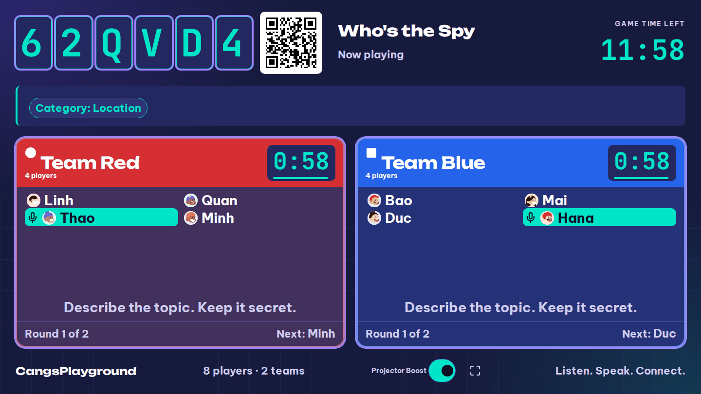
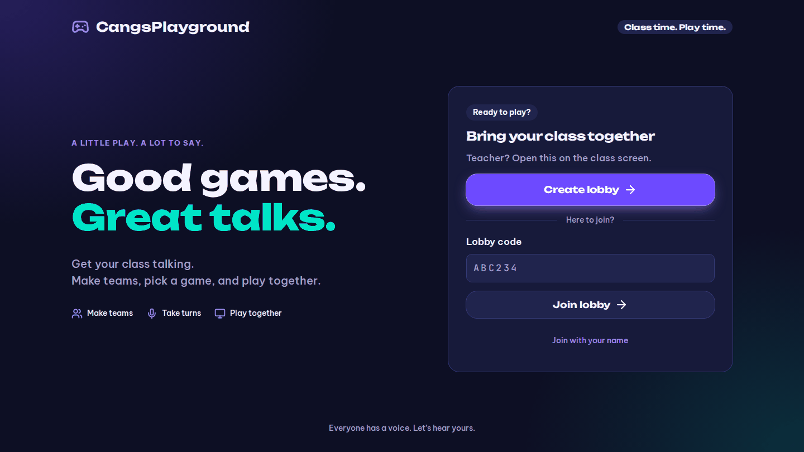
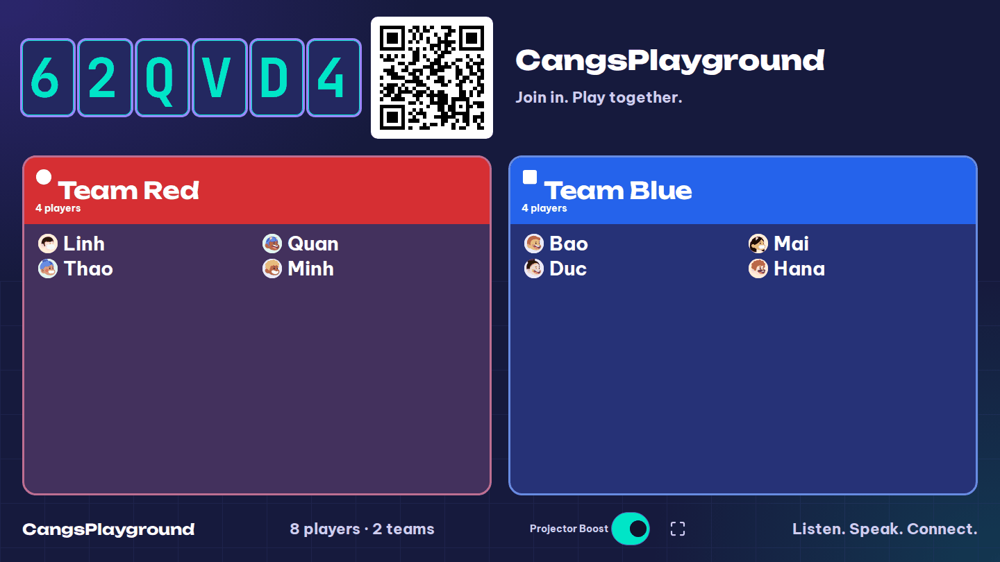
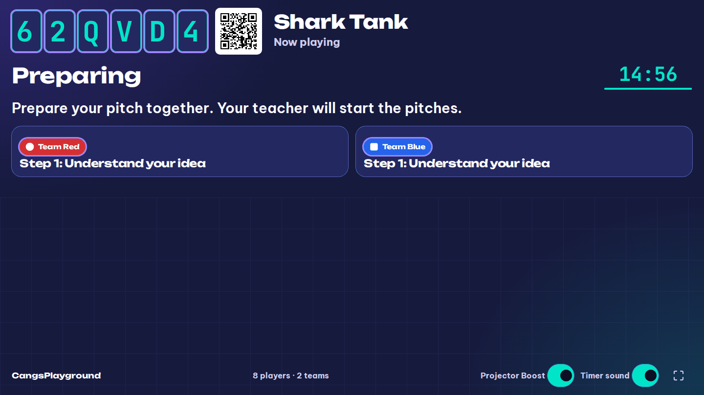
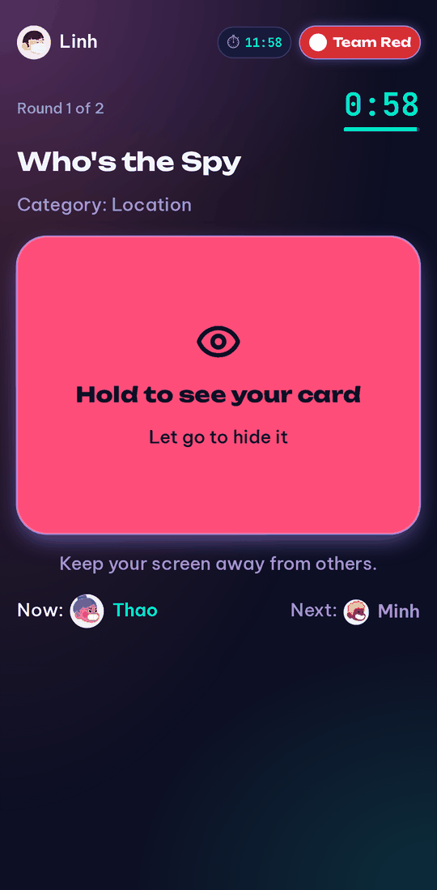
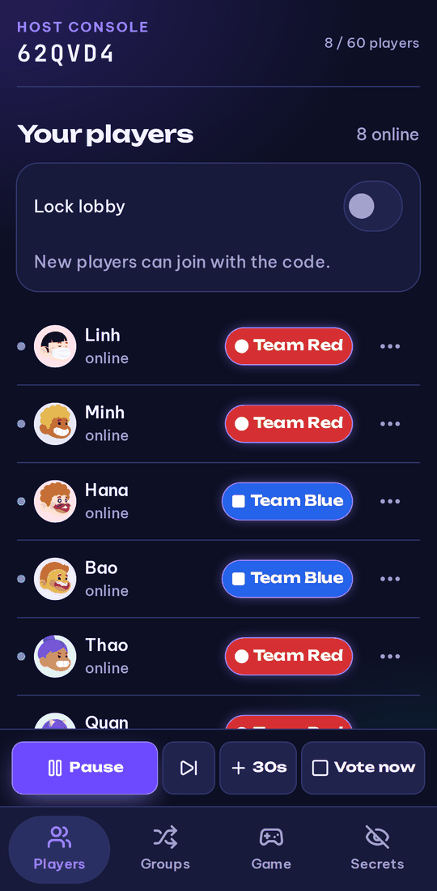

# CangsPlayground

**Good games. Great talks.** A real-time minigame platform that gets a whole classroom speaking English: the teacher
opens a lobby on the projector, students join from their phones with a QR code, and the platform handles teams,
secret roles, and timed turns.

Built for an ESL Speaking Club, no student accounts and no app to install.

<p align="center">
  
</p>

## Why CangsPlayground?

Speaking-club games like Who's the Spy usually run on paper slips, private chat messages and a teacher's stopwatch.
Splitting teams takes minutes, secret roles leak, and nobody sees the same clock.

CangsPlayground turns that routine into one shared flow: **lobby → teams → game → timed turns → reveal**. The same
lobby carries on across rounds, new teams and different games.

## What it does

- **Join in seconds.** Students scan the projector QR or type a 6-character code, enter a name and pick an avatar.
  No accounts. Up to 60 players per lobby.
- **Instant teams.** Split the class by number of teams or maximum team size, and re-shuffle any time.
- **Secrets stay secret.** The projector only shows public information. Roles, cards and secret words go only to the
  host console or the one player who should see them, and are revealed by holding the card.
- **One clock for everyone.** Timers run on the server, so every phone and the projector agree. Phones show
  "YOUR TURN" to the current speaker, and reloading mid-game puts a player back in the same team and turn.
- **Teacher in control from a phone.** Pair a phone through a QR on the projector to pause, skip, add time, call a
  vote, or lock the lobby.
- **Five games, one framework.** Each game is a self-contained module, so adding a game doesn't touch the core.

## Games

| Game | In a sentence |
|---|---|
| **Who's the Spy** | Talk about the topic without saying its name, and find the spy. |
| **Shark Tank** | Pitch a wild product, take questions, then make a deal with your budget. |
| **Guess the Character** | Two teams ask questions in English to guess each other's secret character. |
| **Secret Word** | Everyone gets a secret word to use while speaking. Can your group find it? |
| **Free Talk Timer** | A topic, and fair timed turns for every member of the group. |

Rules and settings: [docs/games.md](docs/games.md).

## Three screens, one lobby

| Screen | Device | Purpose |
|---|---|---|
| Home `/` | Teacher's laptop | Create a lobby or enter a code |
| Projector `/display/:code` | Classroom display | Lobby code, join QR, teams, timers; public information only |
| Host console `/host/:code` | Teacher's phone | Full control, including the private "Secrets" view |
| Player `/join/:code` → `/play/:code` | Student phones | Your team, your card, your turn |

<p align="center">
  
</p>

<p align="center">
  
  
</p>

<p align="center">
  
  &nbsp;&nbsp;&nbsp;
  
</p>

## Quick start

```bash
corepack enable pnpm
pnpm install
pnpm dev          # server on :3000, web app on :5173
```

Open the web app, choose **Create lobby**, and have phones scan the QR code. For classroom use, see the
[Deployment guide](docs/deployment.md) (single Node service, Docker image, Docker Compose, Render blueprint and
Cloudflare Tunnel).

## Documentation

- [Games](docs/games.md): rules and settings
- [Development guide](docs/development.md): setup, tests, acceptance run, adding a game, repository layout
- [Deployment guide](docs/deployment.md): production build, Docker, Render, Cloudflare Tunnel, environment variables
- `docs_v3/prototype/`: PRD, tech stack, design and Phase 1 implementation notes

## Tech stack

TypeScript monorepo (pnpm workspaces): Fastify and Socket.IO on the server, a React web app built with Vite,
shared core and UI packages, and one package per game. Tests run with Vitest.

## Status

Phase 1 prototype. Lobby state is held in memory, so run a single instance; lobbies expire after
`LOBBY_TTL_MINUTES` (default 180).
