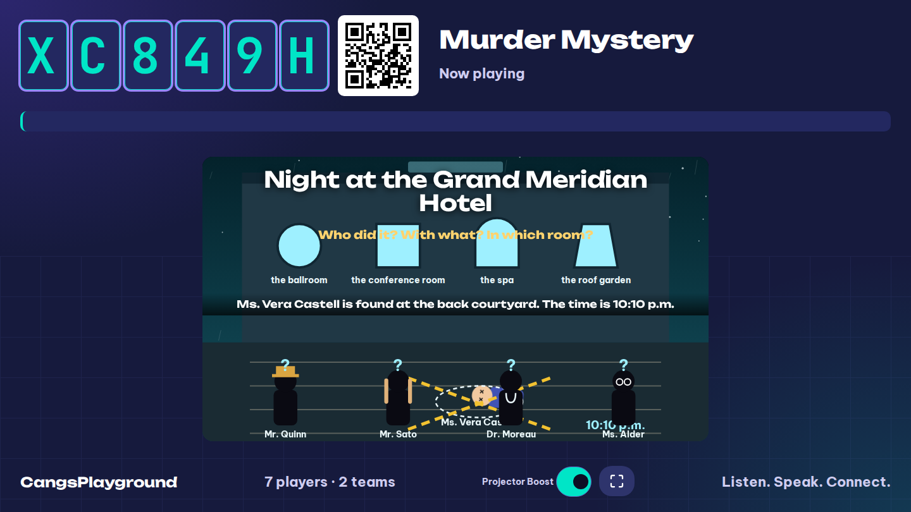

# Murder Mystery implementation and acceptance

Implemented the approved [design](../specs/2026-11-03-murder-mystery-design.md) and
[plan](../plans/2026-11-03-murder-mystery.md) on `worktree-murder-mystery`, in
`.claude/worktrees/murder-mystery`. The original provider transcript was read only as historical
context; its session was not resumed. Unrelated main-checkout Guess the Character edits were preserved.

## Delivered

- Three logical families, two variants each, and two independent scenes (`manor-night`, `hotel-night`).
  Exhaustive finite-world/action-route validation rejects ambiguous, dead-end or unscorable cases.
  Generated entity/card/action IDs are opaque; clue wording, ordering and public rules do not encode
  a fixed culprit slot. Case generation is reproducible from a server-only seed and content version.
- One case and class clock, a fixed 13-second intro, four investigations with rotating leads, private
  clue ownership, shared versioned drafts, one final accusation, evidence scoring and a manual shared
  reveal. Pauses, extensions, reconnects, departures, transfers and late joins retain their permissions.
- Player, host and projector screens; structured NPC questions/challenges; B1 sentence frames and
  Vietnamese vocabulary; staged intro/reveal; reduced-motion support and reload-aware timelines.
- Server/web registration, classroom integration tests, a repeatable browser acceptance script, and
  [teacher instructions](../../games.md#murder-mystery). No new runtime or testing framework dependency.

## Verification

Commands run in the feature worktree with Node 24.21.0 and pnpm 12.14.0:

| Command                                                                                                              | Result                                                                                                                                  |
| -------------------------------------------------------------------------------------------------------------------- | --------------------------------------------------------------------------------------------------------------------------------------- |
| `pnpm --filter @cangsplayground/server test murder-mystery shared-deadlines`                                         | 28 tests passed across four files                                                                                                       |
| `pnpm test`                                                                                                          | 908 passed: core 9; Free Talk 6; Secret Word 5; Spy 16; Shark Tank 169; Guess the Character 80; Murder Mystery 171; server 130; web 322 |
| `pnpm typecheck`                                                                                                     | All workspaces passed                                                                                                                   |
| `pnpm lint`                                                                                                          | Passed                                                                                                                                  |
| `pnpm build`                                                                                                         | Production build passed                                                                                                                 |
| `pnpm --filter @cangsplayground/server exec tsx ../../scripts/acceptance-murder-mystery.mjs /tmp/mm-live-acceptance` | Both scenes passed; four teams total, all scoring 10/10                                                                                 |

One initial full-suite run exceeded the five-second timeout of a single test covering every scoring
route of every configuration while other verification processes ran. The test now runs once per
configuration and retains all route assertions; subsequent full-suite runs passed. The resumed
Socket.IO test's seed assertion initially matched public `avatar.seed`; it now checks every actual
game snapshot/patch for a case seed while retaining full-traffic private-content checks.

The production client boundary was checked by the package import-graph tests and a programmatic Vite
build inspecting Rollup `getModuleIds()`. The only Murder Mystery runtime modules in that build were
`src/views/**` and `src/phrases.ts`: no generator, catalogue, scenes presets, intro builder, validator,
solver, scoring or answer records. To repeat the bundle check:

```bash
pnpm --filter @cangsplayground/web exec node --input-type=module <<'JS'
import { build } from 'vite';
await build({ build: { write: false }, plugins: [{
  name: 'murder-mystery-boundary',
  generateBundle() {
    const ids = [...this.getModuleIds()].filter(id => id.includes('/murder-mystery/src/'));
    const hidden = ids.filter(id => !id.includes('/views/') && !id.endsWith('/phrases.ts'));
    if (hidden.length) throw new Error(hidden.join('\n'));
    console.log('Murder Mystery bundle boundary passed');
  },
}] });
JS
```

Socket tests separately inspect real client snapshots and patches for intro/briefing visibility,
other-team/unopened clues, internal logic and pre-Reveal scores. They cover reconnecting card owners,
offline lead transfer, kicking and same-name rejoining, old-round actions, old-case submit payloads,
and cached host command IDs. Both scenes run on the same server seed through a test-only generator
wrapper. Fake-timer tests prove autonomous phase transitions, fresh briefing time after the intro,
pause/extend invalidation and stale deadline callbacks after Exit/re-Prepare. A generation exception
on Prepare leaves no active partial case.

## Live acceptance

Both complete browser flows passed without browser exceptions.

| Server seed | Case seed | Content | Scene       | Family / variant              | Team sizes | Totals  |
| ----------- | --------- | ------- | ----------- | ----------------------------- | ---------- | ------- |
| 3           | 550505046 | 1       | manor-night | exchange / swapped-recipients | 4 + 3      | 10 + 10 |
| 4           | 916905972 | 1       | hotel-night | access / key-transfer         | 4 + 3      | 10 + 10 |

Chromium uses the built production app;
API calls set up the lobby/teams/case, while the host controls, all eight investigations, card holds,
lead reassignment, proof selection, saving and submitting use actual browser UI.

The acceptance script creates its own ephemeral server, host/projector and seven isolated 320×720
player contexts per case, closes every task-owned connection/server, and leaves unrelated servers
alone. The projector is tested at 1440×810 and in fullscreen. No e2e MCP server or jCodeMunch tool was
available in the resumed harness; existing Playwright/tsx dependencies and local source inspection
were used without installing another framework.

The run checks natural 13-second intro completion and Skip intro, Pause/Resume, paused projector
reload and remaining time, dynamic scene labels, reduced-motion final frames, private clue concealment
on reload, investigation reload, offline lead reassignment, four rounds, separate routes, complete
proof submissions and 10/10 for both teams. It checks no horizontal phone overflow, no browser
exceptions, the shared staged solution/scoreboard, phone tabs and projector reload after the board
begins. Browser font readiness is awaited before testing overlay geometry.

Acceptance found and fixed an actual projector layout defect: the intro's width-based aspect ratio
extended below the shell's available height and intercepted fullscreen-button clicks. The projector
now fits its reserved area, regular content can scroll, and intro typography scales with scene width.
A two-line hotel title also needed more separation from the question; both scene titles, question and caption now have separate browser-checked bounds. The browser script retains
fullscreen, overlay-geometry and 320px overflow checks as repeatable regressions.

Intentional differences from the [approved mockup](../../designs/murder-mystery-screens.html):
the real projector keeps the platform's lobby header/footer, with a fitted scene; SVG art is composed
from reusable schematic scene parts and generated labels rather than copying the sample manor/name.
The hotel has its own building/palette/room shapes. The sample-only flash, haptic and confetti effects are omitted in favor of the specified shared timeline and readable staged content. Phone intro waiting, host Pause/Skip and phone
Result/Solution/Scoreboard navigation use the specified existing components/tabs. Review-only replay
buttons are absent. The game uses server elapsed time rather than replaying animations on reload.

The verified production views (generated case data, not mockup literals):



[320px player investigation screenshot](../../assets/screenshots/murder-mystery-player.png).

## Classroom acceptance still required

No real B1 classroom playtest was performed. A teacher still needs to observe whether each student
shares information, discusses before choosing, changes hypotheses for reasons and explains the final
answer; check vocabulary bottlenecks and the approximately 24-minute pacing. Browser clicks do not
prove English was spoken. The app neither records nor scores speech.

## Implementation rulings

Complete execution decisions, including earlier-session rulings and their stated costs:

- Ruling: reveal-explanation check for false testimony moves from validateCase (T1; CaseLogic has no reveal) to T2 content tests — T1 lacks the data — cost if wrong: one extra validator pass in T2.

- Ruling: terminalPaths counts distinct canonical used-action sets, not orderings — otherwise 'at least two routes' is trivial — cost: none.

- Ruling: known constraint = publicConstraint AND constraints of verified cards held; testimony inert; validator requires verified constraint == all(claims), testimony constraint null — cost: none.

- Ruling: proof set for field F = 1-2 discovered cards where every public world satisfying the set's verified constraints has the true F; testimony card allowed only if verified cards in the same set entail all its claims — makes plan text precise — cost: wording only.

- Ruling: 'initial card matters' = requiredCardId of some action OR (at some reachable terminal) removing it enlarges candidates OR removes all proof sets of a field — plan leaves undefined — cost: stricter/looser content rule if user disagrees.

- Ruling: challenge relevance = some required card has sourceId == targetId — cost: authoring constraint on challenges.

- Ruling: world-universe equality compares (answer, facts), never ids — cost: none.

- Ruling: each card is delivered by exactly one source (initial or one action) so '1-2 NEW cards' holds on every path; redundancy = distinct cards with equal claims — cost: more authored cards.

- Ruling: MurderConfig lives in config.ts (z.infer); types.ts re-exports it in T3 — avoids a duplicate definition; added test/config.test.ts in T1 (not listed) so config defaults have a failing-first test — cost: none.

- Ruling: File Map files keep several top-level type aliases per file (types.ts/model.ts) like sibling games; no nested type declarations — cost: none.

- Task 2: Ruling: CompiledCase gains `targets: Record<id,label>` — T5 ActionOption.targetLabel needs a label source and the plan's CompiledCase has none — cost: one extra field, server-only.

- Task 2: Ruling: the T2/T5 test "descriptor contains no Answer ID" cannot hold literally because roomShapes/suspectBadges must be keyed by all four briefing room/suspect ids (including the culprit and crime room); asserted instead: no weapon name/id, no family/variant/seed, no banned vocabulary, and keys equal exactly the public ids with order shuffled independently of slots — cost: if the user wants stricter, keys would need to be dropped from the descriptor.

- Task 2: Ruling: ScenePreset gains `venue` ({house} placeholder), suspectPool/victims/openings/titles/discoveredTimes fields; discovery times are all >= 10:05 p.m. so they never contradict a crime before nine — cost: none.

- Task 2: Ruling: card text = intro + one sentence per claim (rendered from a lexicon of claim shapes) + note; generation throws on a claim shape it cannot tell, and on a false testimony without a reveal explanation — cost: new claim shapes need a lexicon entry.

- Task 2: Ruling: briefing lists are shuffled independently of slot order and actions/cards are shuffled after id remapping so list position leaks nothing (the truth is always s3/w2/r4 at slot level) — cost: none.

- Task 2: Ruling: expression builders (fact/is/not/all/any) moved to model.ts (second consumer), fixtures re-export them — cost: none.

- Task 3: Ruling: Clock gains durationMs ({endsAt,remainingMs,durationMs}) — toTimerState(clock) must fill TimerState.durationMs and the plan's Clock has no source for it; extend adds to it in T4 — cost: view DTO clock has one more number.

- Task 3: Ruling: harness exposes begin()/next() (advancePhase) instead of host('mm:start') because the reducer arrives in T4; T4 adds host()/player() on the same harness — cost: none.

- Task 3: Ruling: expireDeadline returns null unless key AND endsAt match and now >= endsAt (core also checks; defense in depth); validateTeams(groups) exported for the module's validateGroups hook — cost: none.

- Task 4: Ruling: reduceAction ctx type is SharedArgs minus `shared` (the state is passed separately, as in the sibling game) — cost: none.

- Task 4: Ruling: `mm:submit` needs all three answers plus 1-2 evidence cards in every slot ('complete'); scoring still gives 7 for a right triple with bad evidence — cost: a team that cannot cite any card cannot submit (it always has four starting cards).

- Task 4: Ruling: `mm:transfer` is registered in T5 with the lifecycle code, not here; ScoreBreakdown lives in types.ts; helpers teamOfPlayer/submitterOf/discoveredCardIds live in round.ts for reuse by T5 — cost: none.

- Task 4: Ruling: proof-set equality for scoring is exact set match (order-free) against proofSets(); a superset with an extra verified card is itself enumerated as a valid pair — cost: lenient for pairs where one card alone proves the field.

- Task 5: Ruling: sharedViewFor receives no server time, so canInvestigate/canEdit mean 'clock running and not paused'; the reducer still rejects commands at/after the deadline — cost: for a few ms after a deadline a button may look enabled and the tap is rejected.

- Task 5: Ruling: `intro` is non-null for host and projector in every phase from INTRO on (not only during INTRO) so a reload anywhere keeps it; players never get it — cost: a few hundred bytes per patch.

- Task 5: Ruling: peers see the lead's option list (labels only) with canInvestigate=false so they can discuss; evidence labels are card source labels only — cost: peers learn which sources the team holds, never the text.

- Task 5: Ruling: past lead slots keep a departed player's id (history); only current/future slots are rewritten; transfer is allowed in any phase while the team is active — cost: leadOrder may contain an id that is no longer in members.

- Task 5: Ruling: host `results` stay null until REVEALED like everyone else; the host reads submissions through hostDetails — cost: none.

- Task 5: Ruling: isDraftComplete moved to round.ts so reducer and view share it — cost: none.

- Post-T5 fix (commit 2e27307, advisor finding): Ruling: truth is declared per template (CaseTemplate.truth) instead of always s3/w2/r4; "X or Y" clues are rendered alphabetically; one variant per family was re-authored so the entity named in a house rule is guilty (access/door-access, exchange/swapped-recipients) or the opposite pair member is (alibi/route) — otherwise position/second-name and rule text identified the answer. Tests pin: truth varies per field, rule-named suspect guilty in some templates and innocent in others, true entity is first and second in clue text across seeds, variants differ in cards/reveal/truth. door-access and swapped-recipients challenge actions now also require the guest list (i1) so it stays a useful clue — cost: two prompts mention the guest list.

- Task 6: Ruling: useGameAction was lifted into packages/ui (second consumer) in commit 12c2c23 and Guess the Character re-exports it; none of GTC's uncommitted files were touched — cost: GTC views import the hook through the ui package.

- Task 6: Ruling: client import boundary is pinned by test/boundary.test.ts (static runtime-import walk over src/views/** and phrases.ts: no server module, only react/lucide/ui) — advisor's Review Focus item; package gains @types/node + tsconfig types for it — cost: none.

- Task 6: Ruling: LanguageHelp takes a `phase` prop (content changes per phase per the spec) in addition to hidden/onHiddenChange; RevealSections takes an optional `teamName`; added views/shared.ts (murderView, nameOf) — cost: signatures slightly wider than the plan text.

- Task 6: Ruling: staging is double-encoded: CSS `--d`/`--mm-elapsed` for smooth seeking AND `data-pending` from the same elapsed value so tests and assistive tech see what is on screen — cost: re-render per animation frame while a sequence runs.

- Task 6: Ruling: a challenge in door-access / swapped-recipients lists the guest list as evidence (needs i4 + i1) — see post-T5 fix.

- Task 8: Ruling: seed leak checks inspect every game.shared snapshot/patch; full lobby traffic still checked for logical records and private card bodies — avatar.seed is a public cosmetic identifier, unrelated to generation — cost: game-secret checks must stay scoped to game traffic.

- Task 8: Ruling: intro/reveal fields remain null before their visibility phase, as specified by the DTO/spec, rather than removing the keys as task 8 literally says — cost: null key overhead only.

- Task 8: Ruling: jCodeMunch and e2e MCP are unavailable in this resumed harness; use local source inspection and the existing Playwright acceptance dependency without adding a framework — cost: live acceptance is scripted Playwright, not an e2e MCP walk.

- Task 8: Ruling: split exhaustive scoring test by authored configuration after the monolithic all-configurations test exceeded 5 seconds under concurrent verification load — preserves every route assertion and gives each configuration its own timeout — cost: five extra reported test cases.

- Task 9: Ruling: retain the live browser acceptance as scripts/acceptance-murder-mystery.mjs using existing playwright-core/tsx — the observed fullscreen defect needs a repeatable real-layout regression check; no new framework or production API added — cost: one maintained acceptance script.

- Task 9: Ruling: preserve the platform projector header/footer and use fitted schematic scene art; omit sample-only flash/haptic/confetti, while keeping staged story/scoreboard and required dynamic labels/parts — favors readable content and existing shell integration — cost: less cinematic polish than the static mockup.
